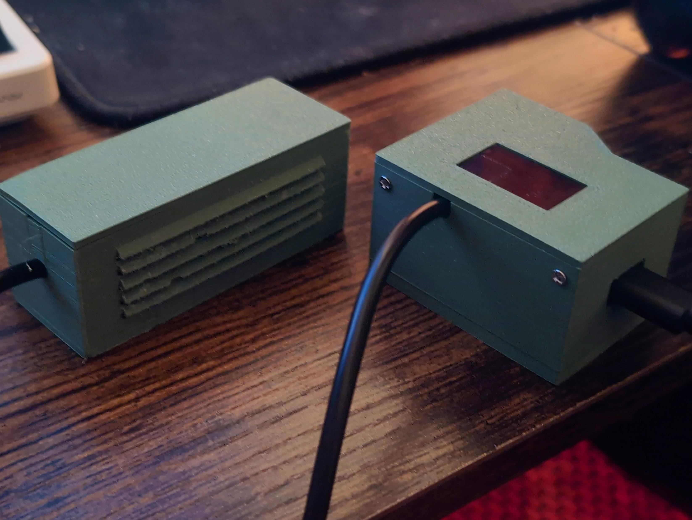
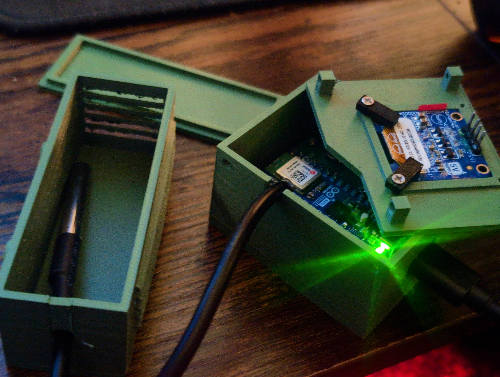
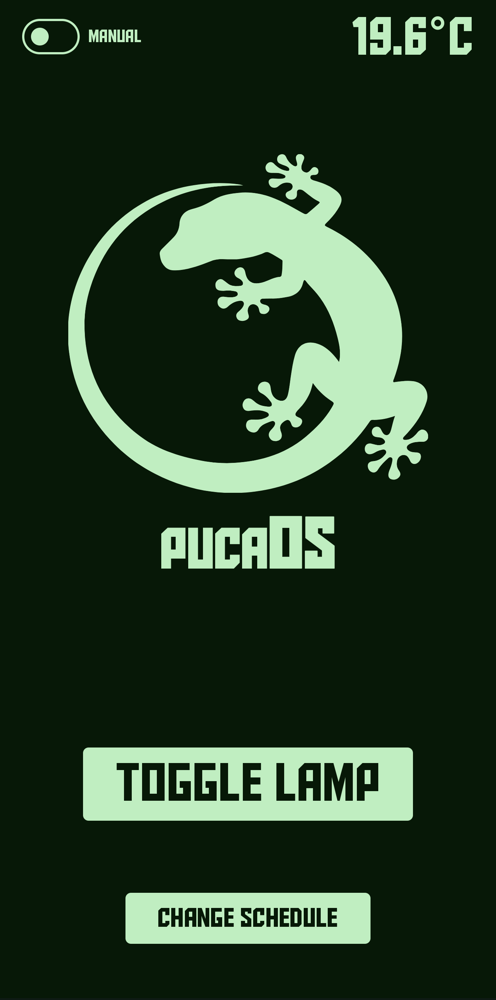
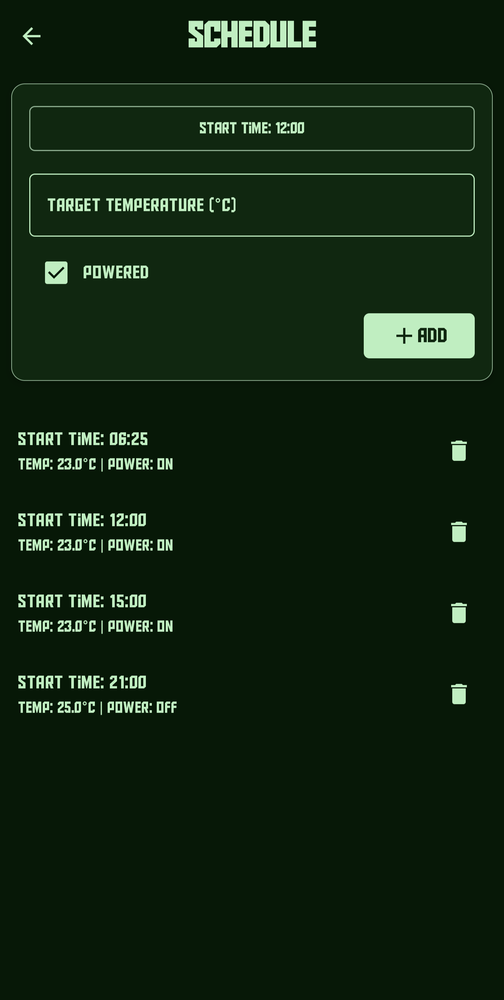
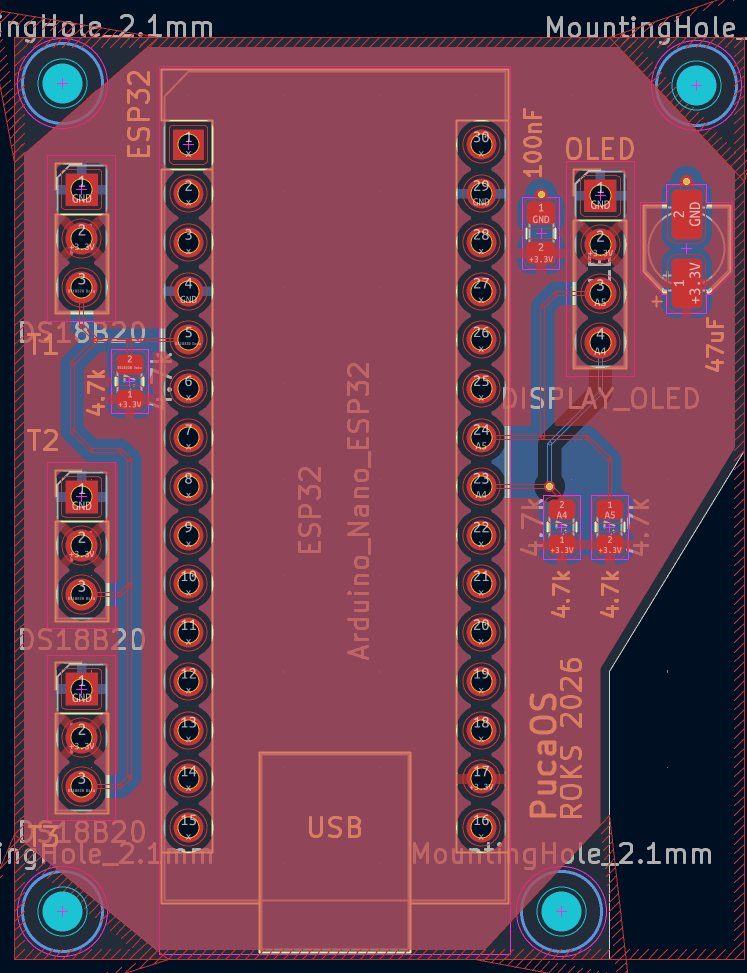
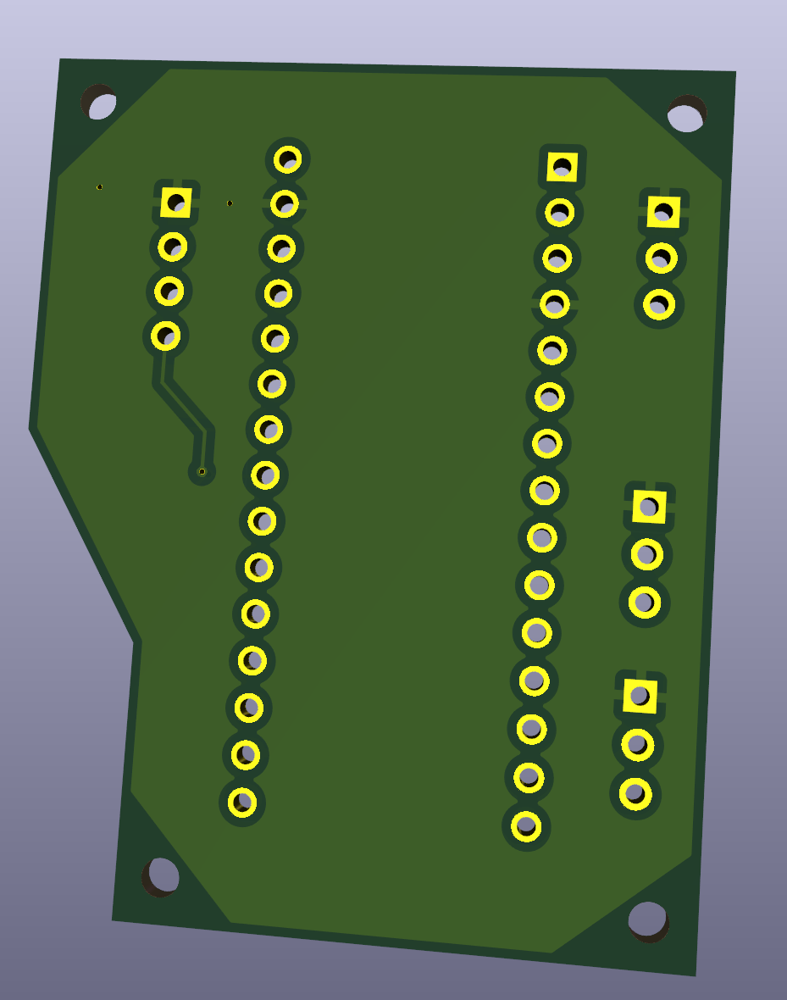

# PucaOS

### **This project is in development. There are safeguards and failsafes that are yet to be implemented! It should not be used to manage a terrarium in its current state!**

PucaOS is an embedded system written for the Arduino Nano ESP32. It includes an accompanying Android app, which allows for remote interfacing with the Arduino.
The Arduino takes in measurements from DS18B20 temperature probes and compares them against a saved schedule. It uses that information to control a Tasmota smart plug
through LAN HTTP commands, to regulate a terrarium's temperature.

## Images

<table align="center">
  <tr>
    <td>
      
      <br><br>
      
    </td>
    <td>
      
    </td>
  </tr>
</table>

<table align="center">
  <tr>
    <td>
      
    </td>
    <td>
      
      <br><br>
      
    </td>
  </tr>
</table>

## Features

* Temperature reading.
* Create and set custom schedules with:
  1. Custom starting times.
  2. Custom set temperatures.
* Manually control the lamp with manual control mode.

## Dependencies

* Mongoose
* DallasTemperature
* OneWire
* Wire
* Adafruit_SSD1306
* Adafruit_GFX

## Technologies
* WiFi
* MQTT
* HTTP
* C/C++
* Kotlin/Java

## Included

1. The source code for the Arduino program.
2. The source code for the Android app.
3. The gerbers and KiCad project files for the PCB.
4. The .STEP files for the housing and Stevenson Screen.

## Implementation

Clone the repository

```bash
git clone https://github.com/SacCno/PucaOS
```

### Arduino

Before beginning the steps below, first make sure to copy 'config.example.h' as 'config.h' and fill in the values with your own.

```bash
cp config.example.h config.h
```

1. Ensure all files are in the same directory as *'PucaOSArduino.ino'*
2. Open Arduino IDE
3. Click 'file -> open...'
4. Select *'PucaOSArduino.ino'*
5. Ensure Arduino Nano ESP32 is connected to the computer and that the appropriate board and port are selected in 'tools'
6. Click 'Upload Sketch'
7. On first start-up, open serial monitor in Arduino IDE where you will be prompted to enter your MQTT password.


### Android

In Android Studio, open the *PucaOS-Android* folder as a project, and let the gradle build.


## License

MIT License - See [LICENSE](LICENSE).