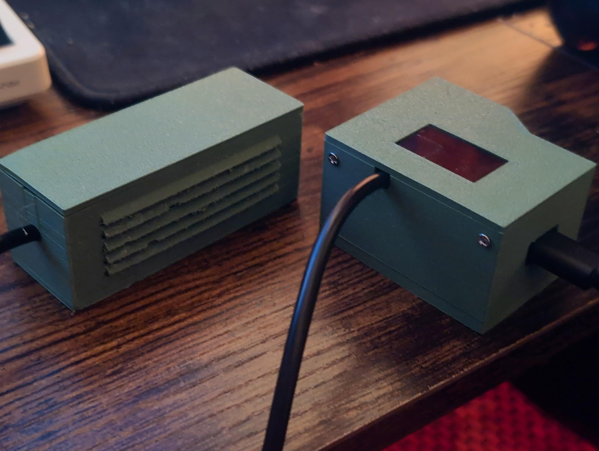
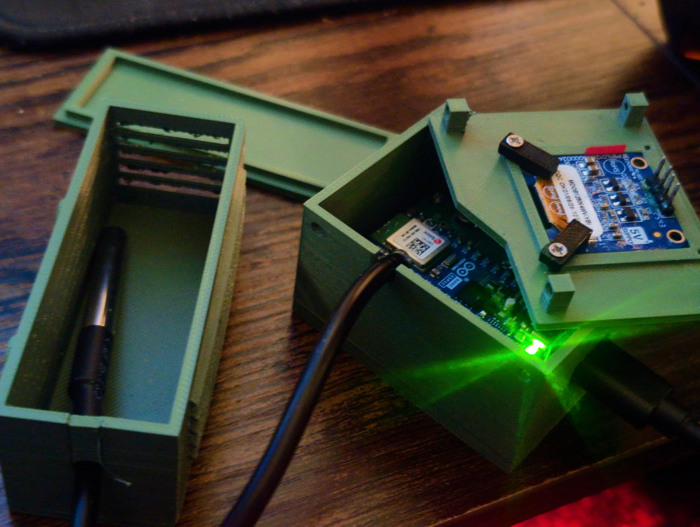
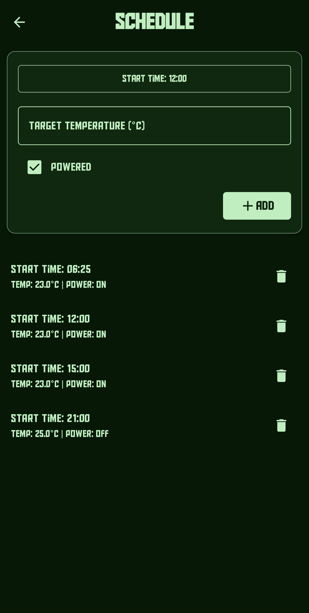
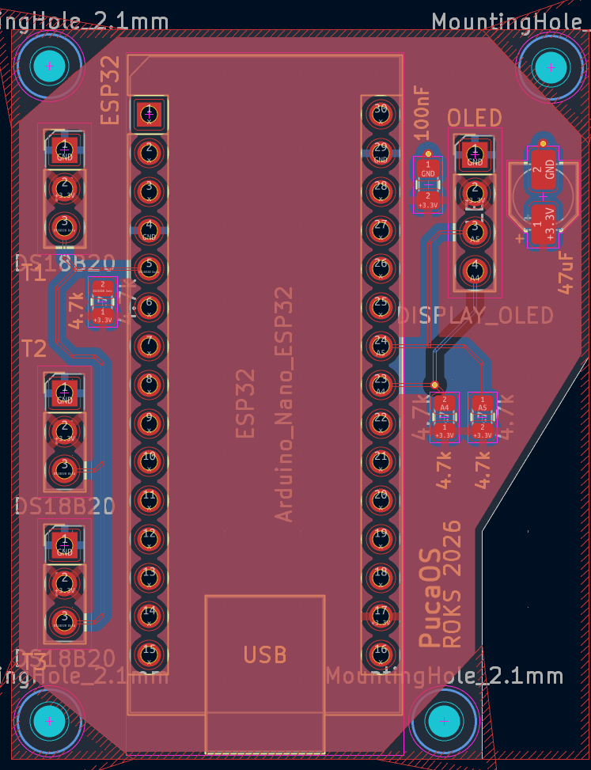
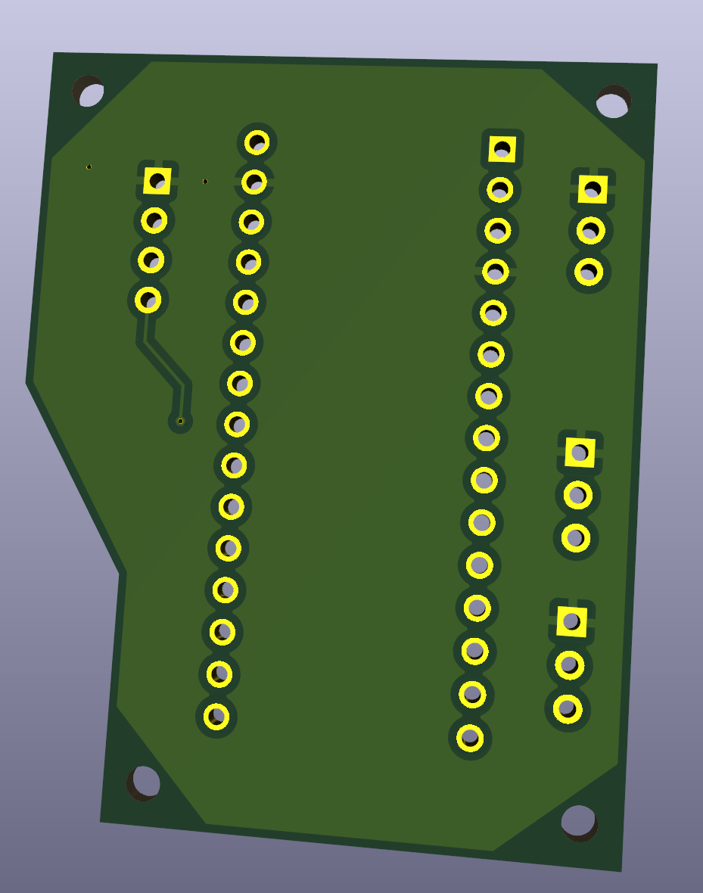

# PucaOS

### **This project is in development. There are safeguards and failsafes that are yet to be implemented! It should not be used to manage a terrarium in its current state!**

PucaOS is an embedded system written for the Arduino Nano ESP32. It includes an accompanying Android app, which allows for remote interfacing with the Arduino.
The Arduino takes in measurements from DS18B20 temperature probes and compares them against a saved schedule. Based on these measurements and the configured schedule, the Arduino controls a Tasmota smart plug over the local network using HTTP commands to regulate the terrarium's temperature.

## Images

<table align="center">
  <tr>
    <td>
      
      <br><br>
      
    </td>
    <td>
      
    </td>
  </tr>
</table>

<table align="center">
  <tr>
    <td>
      
    </td>
    <td>
      
      <br><br>
      
    </td>
  </tr>
</table>

## Features

* Temperature reading.
* Create and set custom schedules with:
  1. Custom starting times.
  2. Custom set temperatures.
* Manually control the lamp with manual control mode.

## Dependencies

* Mongoose
* DallasTemperature
* OneWire
* Wire
* Adafruit_SSD1306
* Adafruit_GFX

## Technologies
* Arduino
* DS18B20
* WiFi
* MQTT
* HTTP
* C/C++
* Kotlin/Java

## Included

1. The source code for the Arduino program.
2. The source code for the Android app.
3. The gerbers and KiCad project files for the PCB.
4. The .STEP files for the housing and Stevenson Screen.

## Implementation

Clone the repository and setup *'config.h'*

```bash
git clone https://github.com/SacCno/PucaOS && cd PucaOS/PucaOS-Arduino && cp config.example.h config.h && cp ../PucaOS-Android/local.example.properties ../PucaOS-Android/local.properties
```

On Powershell you may have to use this command instead.

```bash
git clone https://github.com/SacCno/PucaOS; if ($LASTEXITCODE -eq 0) { Copy-Item PucaOS/PucaOS-Arduino/config.example.h PucaOS/PucaOS-Arduino/config.h; Copy-Item PucaOS/PucaOS-Android/local.example.properties PucaOS/PucaOS-Android/local.properties }
```

### Arduino

The above command will have copied *'config.example.h'* into *'PucaOS-Arduino/'* as *'config.h'*.
This file will be ignored by git so you can safely fill in your details and push commits without sharing your WiFi password! **The program will not run if the values in the new *'config.h'* are not filled in accurately.**

*To connect to your MQTT broker you will need to find their TLS CA certificate and include it in your config.h file. The example file contains the CA cert for HiveMQ Cloud, if you are using a different broker you will need to change the cert.*

To compile and upload the program onto your Arduino Nano ESP32:

1. Ensure all files are in the same directory as *'PucaOS-Arduino.ino'*
2. Open Arduino IDE
3. Click *'File -> Open...'*
4. Select *'PucaOS-Arduino.ino'*
5. Ensure Arduino Nano ESP32 is connected to the computer and that the appropriate board and port are selected in 'tools'
6. Go to *'Tools -> Pin Numbering'* and ensure it is set to *'GPIO'*
7. Click *'Upload Sketch'*


### Android

In Android Studio, open the *PucaOS-Android/* folder as a project, and let the gradle build.

Open *'local.properties,'* which should've been copied into PucaOS-Android with the above command, and fill in your values. This file will also be ignored by Git, so your information is safe.


## License

MIT License - See [LICENSE](LICENSE).